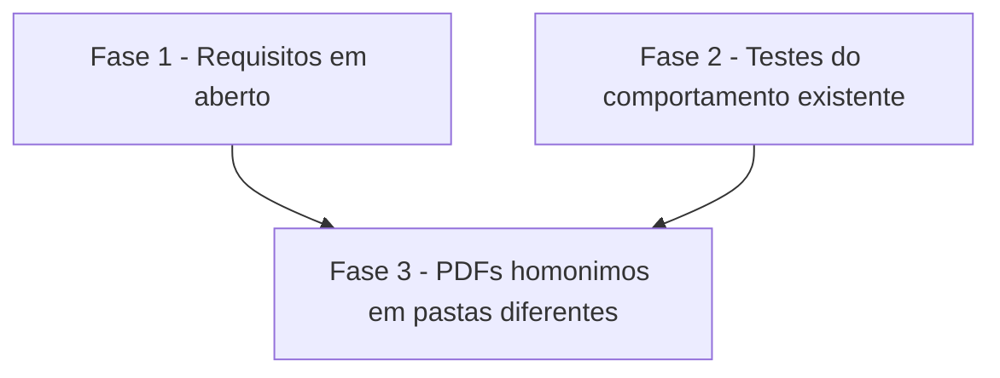

# Tarefas artigo2md - command-line-interface

Escopo: atender FR-014 (PDFs homônimos em pastas diferentes, com a saída repetindo as subpastas da entrada), criar testes para todos os requisitos da linha de comando (meta SC-001) e fechar os itens abertos do checklist de requisitos. Origem: [spec.md](spec.md) e [plan.md](plan.md).

**Legenda de status:**
- `[ ]` Pendente
- `[~]` Em andamento
- `[x]` Concluido
- `[!]` Bloqueado

**Legenda de criticidade:**
- `[C]` Critico - Impacto financeiro direto ou bloqueante
- `[A]` Alto - Funcionalidade essencial
- `[M]` Medio - Necessario mas sem urgencia imediata

---

## FASE 1 - Requisitos em aberto

### 1.1 Fechar ambiguidades e gaps do checklist `[M]`

Ref: checklists/requirements.md CHK004, CHK008, CHK009; research.md Decision 2 (ponto a confirmar)

- [x] 1.1.1 Obter do operador a decisão sobre requisitos do serve quando o host não é o local e registrá-la na spec (CHK004)
- [x] 1.1.2 Registrar na spec o conteúdo do relatório JSON, conforme data-model.md (CHK008)
- [x] 1.1.3 Enumerar na spec os valores de situação de cada motor no doctor, a partir de `src/artigo2md/cli.py` (CHK009)
- [x] 1.1.4 Confirmar com o operador a regra para colisão entre entradas diferentes da mesma execução (research.md Decision 2)
- [x] 1.1.5 Atualizar o checklist com os itens resolvidos

---

## FASE 2 - Testes do comportamento existente

### 2.1 Estrutura de testes da linha de comando `[A]`

Ref: research.md Decisions 4 e 5; quickstart.md Scenario 1

- [x] 2.1.1 Criar `tests/test_cli.py` com um auxiliar que chama a função de entrada com a lista de argumentos e captura saída e código de retorno
- [x] 2.1.2 Criar a fixture que substitui a função de conversão por uma simulação rápida
- [x] 2.1.3 Escrever o teste de ponta a ponta do convert com o motor markitdown sobre a fixture de artigo (FR-001, FR-004, FR-006)

### 2.2 Testes do convert `[A]`

Ref: spec.md FR-001, FR-002, FR-003, FR-005, FR-007, FR-008; quickstart.md Scenarios 2, 3, 5 e 6

- [x] 2.2.1 Escrever o teste da busca recursiva em pasta e do filtro pela extensão pdf (FR-001)
- [x] 2.2.2 Escrever os testes de entrada ignorada com aviso e de código 1 quando nenhum PDF é encontrado (FR-002, FR-003)
- [x] 2.2.3 Escrever os testes de pulo, de sobrescrita e de código 0 quando todos os PDFs são pulados (FR-005)
- [x] 2.2.4 Escrever o teste do relatório JSON ao lado do Markdown (FR-007)
- [x] 2.2.5 Escrever o teste de falha isolada em um PDF, com a contagem final e o código 1 (FR-008)

### 2.3 Testes de serve, doctor e versão `[M]`

Ref: spec.md FR-009, FR-010, FR-011, FR-012, FR-013; research.md Decisions 6 e 7; quickstart.md Scenarios 7 e 8

- [x] 2.3.1 Escrever o teste do serve com valores padrão, com o servidor simulado: host, porta e diretório de dados (FR-009, FR-011)
- [x] 2.3.2 Escrever o teste da opção de abrir o navegador, com o navegador simulado (FR-011)
- [x] 2.3.3 Escrever o teste da porta ocupada: código 1 e sugestão de outra porta (FR-010)
- [x] 2.3.4 Escrever os testes do doctor com a ficha de motores simulada, com e sem motor obrigatório ausente (FR-012)
- [x] 2.3.5 Escrever o teste da opção de versão (FR-013)

---

## FASE 3 - PDFs homônimos em pastas diferentes

### 3.1 Saída espelhando as subpastas da entrada `[A]`

Ref: spec.md FR-014; research.md Decisions 1 e 3; contracts/cli.md; quickstart.md Scenario 4

- [x] 3.1.1 Escrever o teste, inicialmente falhando, de dois PDFs homônimos em subpastas gerando dois Markdown nas subpastas correspondentes
- [x] 3.1.2 Escrever o teste de que um PDF passado diretamente continua na raiz da pasta de saída
- [x] 3.1.3 Implementar em `src/artigo2md/cli.py` o cálculo do caminho de saída relativo à pasta de entrada, criando as subpastas
- [x] 3.1.4 Escrever o teste de que o relatório JSON fica ao lado do Markdown na subpasta
- [x] 3.1.5 Escrever o teste de que a reexecução pula corretamente os arquivos já convertidos no novo layout (FR-005)

### 3.2 Colisão entre entradas diferentes `[M]`

Ref: research.md Decision 2; depende da decisão 1.1.4

- [x] 3.2.1 Escrever o teste, inicialmente falhando, de dois arquivos homônimos passados diretamente na mesma execução
- [x] 3.2.2 Implementar a regra confirmada pelo operador para separar as saídas <!-- 2026-11-21: regra confirmada pelo operador foi recusar com instrução, não separar as saídas -->
- [x] 3.2.3 Escrever o teste da mensagem em português que informa a separação <!-- 2026-11-21: a mensagem testada é a da recusa, com as entradas em conflito e a instrução -->

### 3.3 Documentação e fechamento `[M]`

Ref: spec.md SC-001; checklists/requirements.md CHK014; plan.md Summary item 3

- [x] 3.3.1 Atualizar o README: descrição do layout de saída na conversão de pasta
- [x] 3.3.2 Atualizar a spec: cenários e edge cases pendentes passam a citar as fontes dos testes e FR-014 passa a citar a fonte no código
- [x] 3.3.3 Atualizar o checklist (CHK014) e retirar a marca de proposta de contracts/cli.md
- [x] 3.3.4 Rodar `uv run pytest` e confirmar a suíte verde

---

## Matriz de Dependencias

A fase 2 cria a estrutura de testes usada pela fase 3 e fixa o comportamento atual antes da mudança de layout. A tarefa 3.2 depende da decisão 1.1.4.

## Resumo Quantitativo

| Fase | Tarefas | Subtarefas | Criticidade |
|------|---------|------------|-------------|
| 1 - Requisitos em aberto | 1 | 5 | M |
| 2 - Testes do comportamento existente | 3 | 13 | A, M |
| 3 - PDFs homônimos em pastas diferentes | 3 | 12 | A, M |
| **Total** | **7** | **30** | - |

## Escopo Coberto

| Item | Descricao | Fase |
|------|-----------|------|
| FR-001 a FR-013 | Testes automatizados do comportamento existente da linha de comando | 2 |
| FR-014 | Saída espelhando as subpastas da entrada e tratamento de colisão entre entradas | 3 |
| README | Descrição do novo layout de saída | 3 |
| CHK004, CHK008, CHK009 | Itens abertos do checklist de requisitos | 1 |
| CHK014 | Cenários sem teste como origem | 3 |

## Escopo Excluido

| Item | Descricao | Motivo |
|------|-----------|--------|
| Migração de saídas antigas | Mover Markdown já convertido para o novo layout | Não pedido; a opção de sobrescrita e a reconversão cobrem o caso |
| Autenticação no serve | Senha ou controle de acesso | Decidido na clarificação de web-interface: sem senha, uso local por padrão |
| Novos subcomandos | Qualquer comando além de convert, serve e doctor | Fora do escopo da spec |
