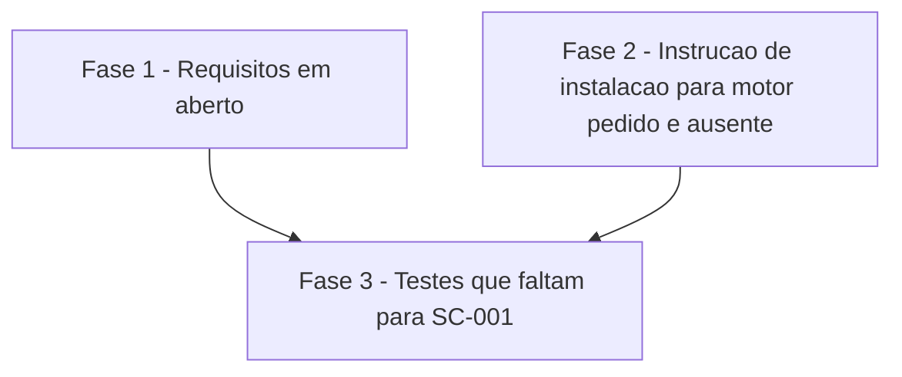

# Tarefas artigo2md - engine-routing

Escopo: fechar a lacuna de FR-017 (instrução de instalação quando o motor pedido não está instalado), criar os testes que faltam para FR-007, FR-008, FR-012, FR-013, FR-014, FR-015 e FR-017 (meta SC-001) e fechar os itens abertos do checklist de requisitos. Origem: [spec.md](spec.md) e [plan.md](plan.md).

**Legenda de status:**
- `[ ]` Pendente
- `[~]` Em andamento
- `[x]` Concluido
- `[!]` Bloqueado

**Legenda de criticidade:**
- `[C]` Critico - Impacto financeiro direto ou bloqueante
- `[A]` Alto - Funcionalidade essencial
- `[M]` Medio - Necessario mas sem urgencia imediata

---

## FASE 1 - Requisitos em aberto

### 1.1 Fechar ambiguidades e gaps do checklist `[M]`

Ref: checklists/requirements.md CHK003, CHK007, CHK008, CHK015; research.md Decisions 6 e 7

- [x] 1.1.1 Registrar na spec o que significa "o PDF tiver texto" em FR-002, a partir de `src/artigo2md/router.py` (CHK007)
- [x] 1.1.2 Registrar na spec a regra de desempate entre resultados com a mesma nota, a partir de `src/artigo2md/router.py` (CHK008)
- [x] 1.1.3 Obter do operador a decisão sobre limite de tempo por motor e por conversão e registrá-la na spec (CHK003, CHK015) <!-- 2026-11-21: manter como está; só o MinerU tem limite de tempo -->
- [x] 1.1.4 Atualizar o checklist com os itens resolvidos

---

## FASE 2 - Instrução de instalação para motor pedido e ausente

### 2.1 Falha com instrução para qualquer motor `[A]`

Ref: spec.md FR-017; research.md Decisions 1 e 2; quickstart.md Scenario 2

- [x] 2.1.1 Escrever os testes, inicialmente falhando para MinerU, Docling e MarkItDown, de que a conversão com motor pedido e ausente falha com a instrução de instalação desse motor
- [x] 2.1.2 Escrever o teste de que, com motor pedido e ausente, nenhum outro motor é tentado
- [x] 2.1.3 Implementar em `src/artigo2md/engines.py` a sinalização uniforme de motor indisponível, inclusive para os motores obrigatórios
- [x] 2.1.4 Implementar em `src/artigo2md/router.py` a instrução de instalação tirada da ficha dos motores quando o motor foi pedido explicitamente <!-- 2026-11-21: não foi preciso alterar o roteador; a instrução vem dos adaptadores e o roteador já a repassa -->
- [x] 2.1.5 Conferir por teste que o modo automático não muda: motor ausente conta como tentativa com erro e o próximo é tentado
- [x] 2.1.6 Atualizar a spec: FR-017 passa a citar a fonte no código e nos testes
- [x] 2.1.7 Rodar `uv run pytest` e confirmar a suíte verde

---

## FASE 3 - Testes que faltam para SC-001

### 3.1 Descontos da nota de qualidade `[A]`

Ref: spec.md FR-007, FR-008; research.md Decision 3; quickstart.md Scenario 3

- [x] 3.1.1 Escrever o teste do desconto por Markdown com menos de 100 caracteres por página (FR-007)
- [x] 3.1.2 Escrever o teste do desconto por saída com menos da metade do texto nativo (FR-008)
- [x] 3.1.3 Escrever o teste da combinação dos descontos com a nota de aceite (FR-007, FR-008, FR-009)

### 3.2 Falhas do roteador `[A]`

Ref: spec.md FR-012, FR-013; research.md Decision 4; quickstart.md Scenarios 4 e 5

- [x] 3.2.1 Escrever o teste da recusa de motor fora da lista, com os motores aceitos na mensagem (FR-012)
- [x] 3.2.2 Escrever o teste de que a falha de todos os motores gera uma mensagem que reúne o erro de cada tentativa (FR-013)
- [x] 3.2.3 Escrever o teste de que a recusa de motor inválido acontece antes da inspeção do PDF (FR-012)

### 3.3 OCR e avisos de progresso `[M]`

Ref: spec.md FR-014, FR-015; research.md Decision 5; quickstart.md Scenario 6

- [x] 3.3.1 Escrever o teste de que o Docling recebe OCR ligado para PDF com páginas escaneadas, com o adaptador simulado (FR-014)
- [x] 3.3.2 Escrever o teste de que o Docling recebe OCR desligado para PDF só com texto (FR-014)
- [x] 3.3.3 Escrever o teste dos avisos de progresso: inspeção, motor em uso e reprovação na avaliação (FR-015)

### 3.4 Fechamento `[M]`

Ref: spec.md SC-001; checklists/requirements.md CHK014

- [x] 3.4.1 Substituir na spec os cenários e edge cases pendentes pelas fontes dos testes
- [x] 3.4.2 Atualizar o checklist: CHK014 resolvido com as fontes dos testes
- [x] 3.4.3 Rodar `uv run pytest`, o gate de cobertura de requisitos e o lint de origem sobre a spec

---

## Matriz de Dependencias

As fases 1 e 2 são independentes entre si. A fase 3 fecha a spec e o checklist depois das duas.

## Resumo Quantitativo

| Fase | Tarefas | Subtarefas | Criticidade |
|------|---------|------------|-------------|
| 1 - Requisitos em aberto | 1 | 4 | M |
| 2 - Instrução de instalação para motor pedido e ausente | 1 | 7 | A |
| 3 - Testes que faltam para SC-001 | 4 | 12 | A, M |
| **Total** | **6** | **23** | - |

## Escopo Coberto

| Item | Descricao | Fase |
|------|-----------|------|
| FR-017 | Instrução de instalação na falha de motor pedido e ausente, para todos os motores | 2 |
| FR-007, FR-008 | Testes dos descontos da nota | 3 |
| FR-012, FR-013 | Testes das falhas do roteador | 3 |
| FR-014, FR-015 | Testes de OCR ligado e dos avisos de progresso | 3 |
| CHK003, CHK007, CHK008, CHK015 | Itens abertos do checklist de requisitos | 1 |
| CHK014 | Requisitos sem teste como origem | 3 |

## Escopo Excluido

| Item | Descricao | Motivo |
|------|-----------|--------|
| FR-001 a FR-006, FR-009, FR-010, FR-011, FR-016 | Requisitos já observados no código e com teste existente | Sem mudança prevista (plan.md, Summary) |
| Valores da nota | Rever os descontos e o corte de aceite | Mantidos pelo operador na clarificação |
| Limite de tempo | Implementar tempo limite por motor ou por conversão | Depende da decisão do operador na tarefa 1.1.3 |
