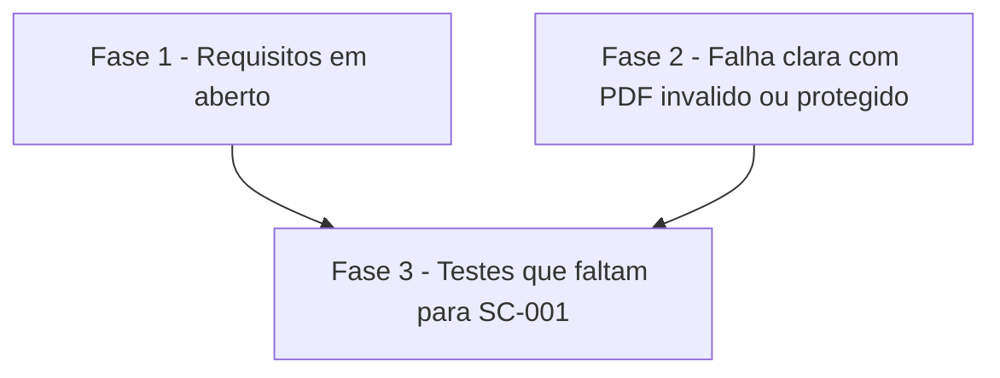

# Tarefas artigo2md - pdf-inspection

Escopo: atender FR-007 (falha clara com PDF inválido ou protegido por senha), criar os testes que faltam para FR-004, FR-007 e FR-008 (meta SC-001) e fechar os itens abertos do checklist de requisitos. Origem: [spec.md](spec.md) e [plan.md](plan.md).

**Legenda de status:**
- `[ ]` Pendente
- `[~]` Em andamento
- `[x]` Concluido
- `[!]` Bloqueado

**Legenda de criticidade:**
- `[C]` Critico - Impacto financeiro direto ou bloqueante
- `[A]` Alto - Funcionalidade essencial
- `[M]` Medio - Necessario mas sem urgencia imediata

---

## FASE 1 - Requisitos em aberto

### 1.1 Fechar ambiguidades e gaps do checklist `[M]`

Ref: checklists/requirements.md CHK006, CHK007, CHK013, CHK014

- [x] 1.1.1 Enumerar na spec os símbolos e termos de indício de fórmula de FR-004, a partir de `src/artigo2md/pdfscan.py` (CHK006)
- [x] 1.1.2 Enumerar na spec os termos de artigo científico de FR-005, a partir de `src/artigo2md/pdfscan.py` (CHK007)
- [x] 1.1.3 Obter do operador a decisão sobre requisito de tempo de inspeção por documento e registrá-la na spec (CHK013)
- [x] 1.1.4 Obter do operador a decisão sobre o risco aceito da heurística por termos (CHK014)
- [x] 1.1.5 Atualizar o checklist com os itens resolvidos

---

## FASE 2 - Falha clara com PDF inválido ou protegido

### 2.1 Erro de domínio na inspeção `[A]`

Ref: spec.md FR-007; research.md Decisions 1 a 3 e 7; quickstart.md Scenarios 3 e 4

- [x] 2.1.1 Criar em `tests/conftest.py` as fixtures de arquivo que não é PDF e de PDF protegido por senha
- [x] 2.1.2 Escrever os testes, inicialmente falhando, do erro de domínio com mensagem em português para cada um dos dois casos
- [x] 2.1.3 Implementar em `src/artigo2md/pdfscan.py` o erro de domínio e a captura da exceção do pypdfium2 na abertura do documento
- [x] 2.1.4 Tratar código de erro ausente ou desconhecido com a mensagem genérica (risco de versão do pypdfium2, research.md Decision 1)
- [x] 2.1.5 Escrever o teste de que a conversão pelo roteador de um PDF inválido não aciona nenhum motor
- [x] 2.1.6 Rodar `uv run pytest` e confirmar a suíte verde <!-- 2026-11-20: 22 passed, 1 skipped -->

### 2.2 Efeito nos pontos de entrada `[M]`

Ref: research.md Decision 2

- [x] 2.2.1 Escrever o teste de que um job da interface web com PDF protegido por senha termina em erro com a mensagem em português
- [x] 2.2.2 Conferir que o convert da linha de comando mostra a mensagem em português para PDF inválido (teste na feature command-line-interface ou verificação manual registrada) <!-- verificação manual em 2026-11-20: o convert mostrou "não é um PDF válido" e "está protegido por senha" e terminou com código 1 -->
- [x] 2.2.3 Atualizar a spec: retirar de FR-007 a nota de requisito ainda não observado e citar a fonte no código e no teste

---

## FASE 3 - Testes que faltam para SC-001

### 3.1 Indício de fórmula `[M]`

Ref: spec.md FR-004; research.md Decision 6; quickstart.md Scenario 2

- [x] 3.1.1 Criar em `tests/conftest.py` a fixture de PDF cujo texto contém o termo de fórmula
- [x] 3.1.2 Escrever o teste de que a pontuação de fórmula da análise é maior que zero
- [x] 3.1.3 Substituir na spec o cenário pendente de FR-004 pela fonte do teste

### 3.2 Inspeção sem acesso à rede `[A]`

Ref: spec.md FR-008; research.md Decision 5; quickstart.md Scenario 5

- [x] 3.2.1 Criar a fixture de teste que substitui a criação de sockets por uma função que falha
- [x] 3.2.2 Escrever o teste de que a inspeção da fixture de artigo termina sem tentar abrir socket
- [x] 3.2.3 Escrever o teste de controle que comprova que a fixture de bloqueio realmente falha quando um socket é aberto
- [x] 3.2.4 Substituir na spec o edge case pendente de FR-008 pela fonte do teste

### 3.3 Fechamento `[M]`

Ref: spec.md SC-001; checklists/requirements.md CHK012

- [x] 3.3.1 Rodar `uv run pytest` e confirmar a suíte verde
- [x] 3.3.2 Atualizar o checklist: CHK012 resolvido com as fontes dos testes
- [x] 3.3.3 Rodar o gate de cobertura de requisitos e o lint de origem sobre a spec atualizada

---

## Matriz de Dependencias

As fases 1 e 2 são independentes entre si. A fase 3 vem por último porque o fechamento (3.3) depende das duas e as fixtures de 2.1 e 3.1 ficam no mesmo arquivo.

## Resumo Quantitativo

| Fase | Tarefas | Subtarefas | Criticidade |
|------|---------|------------|-------------|
| 1 - Requisitos em aberto | 1 | 5 | M |
| 2 - Falha clara com PDF inválido ou protegido | 2 | 9 | A, M |
| 3 - Testes que faltam para SC-001 | 3 | 10 | A, M |
| **Total** | **6** | **24** | - |

## Escopo Coberto

| Item | Descricao | Fase |
|------|-----------|------|
| FR-007 | Falha clara em português para PDF inválido ou protegido por senha | 2 |
| FR-004 | Teste do indício de fórmula | 3 |
| FR-008 | Teste de que a inspeção não acessa a rede | 3 |
| CHK006, CHK007, CHK013, CHK014 | Itens abertos do checklist de requisitos | 1 |
| CHK012 | Requisitos sem teste como origem | 3 |

## Escopo Excluido

| Item | Descricao | Motivo |
|------|-----------|--------|
| FR-001, FR-002, FR-003, FR-005, FR-006 | Requisitos já observados no código e com teste existente | Sem mudança prevista (plan.md, Summary) |
| Arquivo inexistente | Tratamento de caminho que não existe | Fora de FR-007 (research.md, Decision 4) |
| Suporte a senha | Abrir PDF protegido informando a senha | Não pedido; FR-007 define apenas a falha clara |
