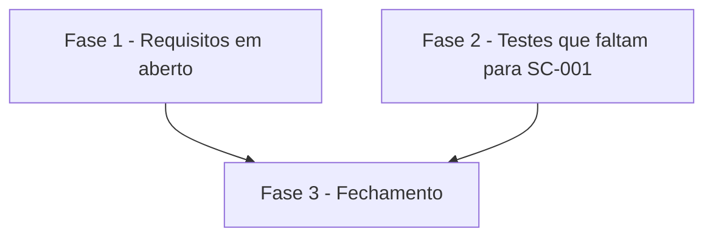

# Tarefas artigo2md - web-interface

Escopo: criar os testes que faltam para FR-007 a FR-013 (meta SC-001), citar os testes que já cobrem FR-014, fechar os itens abertos do checklist de requisitos e conferir o contrato da API com um cenário de ida e volta. Nenhuma mudança de código de produção está prevista. Origem: [spec.md](spec.md) e [plan.md](plan.md).

**Legenda de status:**
- `[ ]` Pendente
- `[~]` Em andamento
- `[x]` Concluido
- `[!]` Bloqueado

**Legenda de criticidade:**
- `[C]` Critico - Impacto financeiro direto ou bloqueante
- `[A]` Alto - Funcionalidade essencial
- `[M]` Medio - Necessario mas sem urgencia imediata

---

## FASE 1 - Requisitos em aberto

### 1.1 Fechar ambiguidades e gaps do checklist `[M]`

Ref: checklists/requirements.md CHK007, CHK008, CHK009, CHK015; research.md Decisions 6 e 7

- [x] 1.1.1 Registrar na spec o conjunto de caracteres permitido no nome de saída, a partir de `src/artigo2md/web.py` (CHK007)
- [x] 1.1.2 Registrar na spec a assinatura que identifica um PDF no envio, a partir de `src/artigo2md/web.py` (CHK008)
- [x] 1.1.3 Registrar na spec os valores aceitos para o motor no envio, a partir de `src/artigo2md/router.py` (CHK009)
- [x] 1.1.4 Obter do operador a decisão sobre tamanho máximo da fila de conversão e registrá-la na spec (CHK015) <!-- 2026-11-21: sem tamanho máximo -->
- [x] 1.1.5 Atualizar o checklist com os itens resolvidos

---

## FASE 2 - Testes que faltam para SC-001

### 2.1 Conversão simulada e jobs em andamento `[A]`

Ref: spec.md FR-008, FR-010, FR-012; research.md Decision 1; quickstart.md Scenario 3

- [x] 2.1.1 Criar em `tests/test_web.py` a fixture que substitui a conversão por uma simulação que avisa uma etapa e fica parada até ser liberada
- [x] 2.1.2 Escrever o teste de que a etapa do job mostra o aviso de progresso recebido (FR-012)
- [x] 2.1.3 Escrever o teste do 409 ao pedir o Markdown de um job ainda não convertido (FR-008)
- [x] 2.1.4 Escrever o teste do 409 ao apagar um job em andamento (FR-010)
- [x] 2.1.5 Conferir no mesmo teste que, depois de liberada, a conversão conclui e o job pode ser apagado

### 2.2 Reinício, job inexistente e zip `[A]`

Ref: spec.md FR-007, FR-009, FR-011; research.md Decisions 2 a 4; quickstart.md Scenarios 2, 4 e 5

- [x] 2.2.1 Escrever o teste de que jobs gravados em fila ou em andamento aparecem como erro por interrupção ao recriar a aplicação (FR-011)
- [x] 2.2.2 Escrever o teste do 404 para job inexistente na consulta, no Markdown e na remoção (FR-007)
- [x] 2.2.3 Escrever o teste do zip com dois arquivos de mesmo nome, com nomes distintos dentro do zip (FR-009)
- [x] 2.2.4 Escrever o teste do zip pedindo só alguns identificadores (FR-009)

### 2.3 Nome de saída e contrato da API `[M]`

Ref: spec.md FR-013; research.md Decisions 4 e 8; quickstart.md Scenarios 6 e 7; contracts/api.md

- [x] 2.3.1 Escrever o teste da sanitização do nome de saída: caracteres fora do conjunto, nome vazio e limite de tamanho (FR-013)
- [x] 2.3.2 Escrever o teste de ida e volta que compara os campos da resposta real com `docs/specs/web-interface/contracts/api.md` e com os campos que a página estática lê
- [x] 2.3.3 Corrigir `docs/specs/web-interface/contracts/api.md` ou `docs/specs/web-interface/data-model.md` se o teste de ida e volta revelar divergência <!-- 2026-11-21: o teste de ida e volta não revelou divergência; nada a corrigir -->

---

## FASE 3 - Fechamento

### 3.1 Spec, checklist e verificação `[M]`

Ref: spec.md SC-001, FR-014; checklists/requirements.md CHK014; research.md Decision 5

- [x] 3.1.1 Substituir na spec os cenários e edge cases pendentes pelas fontes dos testes, inclusive os de FR-014 que já existem
- [x] 3.1.2 Atualizar o checklist: CHK014 resolvido com as fontes dos testes
- [x] 3.1.3 Rodar `uv run pytest`, o gate de cobertura de requisitos e o lint de origem sobre a spec

---

## Matriz de Dependencias

As fases 1 e 2 são independentes entre si. Dentro da fase 2, as tarefas 2.1 e 2.2 usam a mesma conversão simulada criada em 2.1.1.

## Resumo Quantitativo

| Fase | Tarefas | Subtarefas | Criticidade |
|------|---------|------------|-------------|
| 1 - Requisitos em aberto | 1 | 5 | M |
| 2 - Testes que faltam para SC-001 | 3 | 12 | A, M |
| 3 - Fechamento | 1 | 3 | M |
| **Total** | **5** | **20** | - |

## Escopo Coberto

| Item | Descricao | Fase |
|------|-----------|------|
| FR-008, FR-010, FR-012 | Testes de job em andamento: progresso e respostas 409 | 2 |
| FR-007, FR-009, FR-011 | Testes de job inexistente, zip e reinício | 2 |
| FR-013 | Teste da sanitização do nome de saída | 2 |
| Contrato da API | Teste de ida e volta contra o contrato e a página | 2 |
| FR-014 | Citação dos testes existentes | 3 |
| CHK007, CHK008, CHK009, CHK015 | Itens abertos do checklist de requisitos | 1 |
| CHK014 | Requisitos sem teste como origem | 3 |

## Escopo Excluido

| Item | Descricao | Motivo |
|------|-----------|--------|
| FR-001 a FR-006 | Requisitos já observados no código e com teste existente | Sem mudança prevista (plan.md, Summary) |
| Autenticação | Senha ou controle de acesso | Decidido na clarificação: sem senha, uso local por padrão |
| Limites de envio e limpeza automática | Limite de tamanho, de quantidade e retenção | Decidido na clarificação: sem limite e só remoção manual |
| Teste da página em navegador | Automação de navegador para a página estática | Dependência nova, fora do escopo de SC-001 (research.md, Decision 8) |
